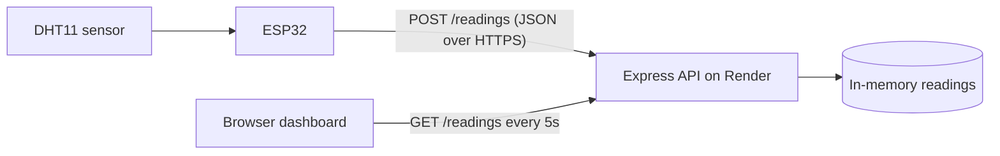

# ESP32 Weather App

A small end-to-end IoT project: an **ESP32** reads temperature and humidity, sends the data over Wi-Fi to a **Node.js / Express** API hosted on Render, and a **live web dashboard** shows the readings with an animated thermometer, a humidity cloud, trend charts and alerts.


**Live dashboard:** https://esp32-weatherapp-api.onrender.com


---

## How it works



1. The ESP32 reads humidity and temperature from the sensor.
2. Every few readings it sends `{ "humidity": …, "temperature": … }` to the API and blinks the LED three times on success.
3. The API stamps each reading with an ISO date and stores it.
4. The dashboard polls the API every 5 seconds and updates the page.

## Features

**Dashboard**
- Animated thermometer whose mercury level and colour follow the temperature
- Humidity cloud that fills with water, and rains when humidity is 75% or higher
- Live, stale and offline connection status
- Min, average and max for each metric
- Feels like, dew point and comfort level
- Trend chart with hover tooltips and a selectable range (20, 50, 200 or all readings)
- Configurable alert thresholds, saved in the browser
- °C/°F toggle, light and dark theme, CSV export
- Responsive layout, keyboard accessible, respects reduced motion

**Firmware**
- Wi-Fi connection with automatic reporting to the API
- LED feedback on successful uploads
- Simulated readings for testing without a sensor (switch to the real DHT with two lines)

**API**
- Minimal REST API with JSON responses
- Serves the dashboard as static files from the same server

## Project structure

```
esp32-weatherapp/
├── api/
│   ├── data/
│   │   └── readings.js      # In-memory readings store
│   ├── public/
│   │   └── index.html       # Dashboard (served statically)
│   ├── package.json
│   └── server.js            # Express server
├── weatherd/
│   └── weatherd.ino         # ESP32 firmware
└── .gitignore
```

## Getting started

### Prerequisites

- An ESP32 development board
- A DHT11 or DHT22 sensor (optional while testing, the firmware can simulate readings)
- [Node.js](https://nodejs.org/) 18 or newer
- [Arduino IDE](https://www.arduino.cc/en/software) with ESP32 board support

### 1. Run the API

```bash
cd api
npm install
node server.js
```

Open http://localhost:3000 to see the dashboard. The server listens on `PORT` if set, otherwise 3000.

> The server uses ES module imports, so `api/package.json` must contain `"type": "module"`.

### 2. Flash the ESP32

1. Install these libraries from the Arduino Library Manager:
   - `ESP32HTTPClient`
   - `DHT sensor library` (Adafruit)
   - `ArduinoJson`
2. Open `weatherd/weatherd.ino`.
3. Set your values at the top of the sketch:

   ```cpp
   ESP32HTTPClient client("https://your-api-url");   // your deployed or tunnelled API
   const char* WIFI_SSID = "your-wifi-name";
   const char* WIFI_PASS = "your-wifi-password";
   ```

4. Select your ESP32 board and port, then upload.
5. Open the Serial Monitor at **115200 baud** to watch readings and upload results.

### 3. Use the real sensor

By default the sketch sends random demo values. To use the DHT sensor, in `loop()` uncomment these two lines and remove the two `genReadingValue` lines below them:

```cpp
float humidity = dht.readHumidity();
float tempC = dht.readTemperature();
```

If you use a DHT22 instead of a DHT11, change `#define DHTTYPE DHT11` to `DHT22`.

## Wiring

| Component | ESP32 pin | Notes |
|-----------|-----------|-------|
| DHT data  | GPIO 4    | Add a 10 kΩ pull-up to 3.3V if your module has none |
| DHT VCC   | 3.3V      | |
| DHT GND   | GND       | |
| LED anode | GPIO 26   | Use a 220 Ω resistor in series, cathode to GND |

## API reference

Base URL: `http://localhost:3000` locally, or your deployed URL.

| Method | Endpoint     | Description               |
|--------|--------------|---------------------------|
| GET    | `/readings`  | List all stored readings  |
| POST   | `/readings`  | Add a new reading         |

### `GET /readings`

```json
{
  "data": [
    { "humidity": 62.4, "temperature": 27.8, "date": "2026-11-15T10:30:00.000Z" }
  ],
  "message": "Reading all data"
}
```

### `POST /readings`

Request body:

```json
{ "humidity": 62.4, "temperature": 27.8 }
```

Response (`201 Created`):

```json
{ "message": "Reading added to data" }
```

Quick test:

```bash
curl -X POST http://localhost:3000/readings \
  -H "Content-Type: application/json" \
  -d '{"humidity": 62.4, "temperature": 27.8}'
```

## Deployment

The API is deployed on [Render](https://render.com) as a Node web service:

| Setting         | Value            |
|-----------------|------------------|
| Root directory  | `api`            |
| Build command   | `npm install`    |
| Start command   | `node server.js` |

Point the ESP32 sketch at your Render URL. On Render's free tier the service sleeps after inactivity, so the first request after a pause can take up to a minute.

## Known limitations

- **Readings are stored in memory.** They reset whenever the server restarts or redeploys. A database (SQLite, MongoDB or Postgres) is the natural next step.
- **No authentication or input validation yet.** Anyone who knows the URL can post data. The sketch already defines an `API_KEY`, but the server does not check it.
- **The readings list grows without limit.** Cap it or paginate it for long-running deployments.
- `GET /readings/:date` currently returns all readings instead of the matching one.

## Roadmap

- [ ] Persistent storage
- [ ] API key check on `POST /readings`
- [ ] Input validation and a size cap on stored readings
- [ ] Date-range filtering on `GET /readings`
- [ ] Deep sleep on the ESP32 for battery use
- [ ] Real DHT readings enabled by default

## Security note

Never commit real Wi-Fi passwords or API keys. Keep them in a separate `secrets.h` file that is listed in `.gitignore`, and commit only a `secrets.example.h` with placeholder values.

## Author

Built by [Osiaru Tech](https://osiaru.top/).